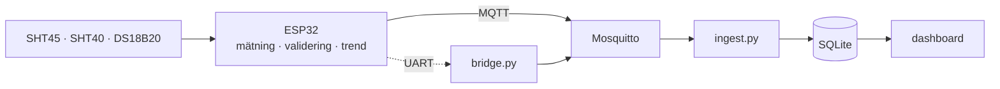

# MicroHydros

Teknisk prototyp för HydroGreen Fingers AB. Ett inbyggt system som mäter
klimatet i en liten hydroponisk odling, avgör om varje mätvärde går att lita på,
och skickar resultatet vidare till ett externt system som lagrar historiken.

Projekt 1, IoT- och embeddedutvecklare, 31 augusti till 25 september 2026.

---

## Vad systemet gör

Fyra mätpunkter läses var tionde sekund:

| Mätpunkt | Givare | Gränssnitt |
|---|---|---|
| Lufttemperatur inne | SHT45 | I²C 0x44 |
| Lufttemperatur ute | SHT40-BD1B | I²C 0x45 |
| Vattentemperatur | DS18B20 i vattentät sond | 1-Wire |
| Relativ luftfuktighet inne | SHT45 | I²C 0x44 |

Utöver det räknas daggpunkt och ångtrycksdeficit fram ombord, varje mätvärde
får en kvalitetsflagga med orsakskod, och enheten säger till i förväg när
temperaturen är på väg mot en skadlig nivå.

Telemetrin skickas varje minut över MQTT, och speglas samtidigt på UART.



---

## Status

| | |
|---|---|
| Tester | 82 av 82 godkända, under 6 sekunder |
| Firmware för ESP32 | bygger, RAM 24,2 %, flash 59,8 % |
| Hela kedjan mätvärde till databas | verifierad i fyra scenarier |
| **Verifierad mot fysisk hårdvara** | **nej**, se nedan |

**Viktigt:** prototypen är utvecklad och verifierad mot en fysikalisk
simuleringsmodell av odlingsskåpet, inte mot monterade givare. Firmwaren
kompilerar för ESP32 och drivrutinerna är skrivna mot databladen, men I²C-timing,
kabellängder och verklig kondens är inte provade. Vad det betyder i detalj står i
[teknisk dokumentation, avsnitt 10.1](docs/teknisk-dokumentation.md#101-prototypen-är-verifierad-i-simulering-inte-på-fysisk-hårdvara).

---

## Beroenden

| Verktyg | Version | Behövs för |
|---|---|---|
| PlatformIO Core | 6.2 eller senare | bygga och testa firmware |
| Python | 3.9 eller senare | gateway |
| Docker med Compose | valfri aktuell | broker, mottagare och panel |

Python-paket: `paho-mqtt`, och `pyserial` bara om bryggan ska läsa en fysisk
seriell port.

### Installation

```bash
python3 -m venv .venv
.venv/bin/pip install platformio paho-mqtt
```

---

## Kom igång

### 1. Kör testerna

Snabbaste sättet att se att allt fungerar. Ingen hårdvara behövs.

```bash
cd firmware
../.venv/bin/pio test -e native
```

Förväntat: `82 test cases: 82 succeeded`.

### 2. Starta gatewayen

```bash
cd gateway
docker compose up -d --build
```

Tre tjänster startar: Mosquitto på port 1883, mottagaren som lagrar i SQLite, och
instrumentpanelen på <http://localhost:8088>.

### 3. Mata in data

Bygg simuleringsnoden och koppla den till gatewayen:

```bash
cd firmware && ../.venv/bin/pio run -e simnode

cd ../gateway
../firmware/.pio/build/simnode/program --scenario normal --hours 6 \
  | ../.venv/bin/python bridge.py --stdin --host localhost
```

Öppna <http://localhost:8088> så syns mätvärdena med kurvor.

### 4. Prova felscenarierna

```bash
SIM=../firmware/.pio/build/simnode/program
PY=../.venv/bin/python

$SIM --scenario faults   --hours 6 | $PY bridge.py --stdin   # injicerade givarfel
$SIM --scenario outage   --hours 6 | $PY bridge.py --stdin   # nätavbrott
$SIM --scenario heatwave --hours 6 | $PY bridge.py --stdin   # skenande uppvärmning
```

Varje scenario rapporterar som en egen enhet, så alla fyra kan ligga i databasen
samtidigt och jämföras i panelen.

Följ vad mottagaren upptäcker:

```bash
docker compose logs -f ingest
```

### 5. Bygga firmware för hårdvaran

```bash
cd firmware
../.venv/bin/pio run -e esp32dev              # bygg
../.venv/bin/pio run -e esp32dev -t upload    # flasha
../.venv/bin/pio device monitor               # följ seriellt
```

Ändra först nätverksuppgifterna i [`firmware/src/config.h`](firmware/src/config.h),
eller sätt dem vid bygget:

```bash
../.venv/bin/pio run -e esp32dev \
  -D MH_WIFI_SSID='"mitt-nät"' \
  -D MH_WIFI_PASS='"lösenord"' \
  -D MH_MQTT_HOST='"192.168.1.10"'
```

Med ett kort inkopplat kan bryggan läsa den seriella porten direkt:

```bash
../.venv/bin/pip install pyserial
../.venv/bin/python bridge.py --serial /dev/cu.usbserial-0001 --host localhost
```

### Stoppa

```bash
cd gateway
docker compose down      # data ligger kvar i volymen
docker compose down -v   # raderar även databasen
```

---

## Anslutning av givare

```
ESP32 DevKitC                                  4,7 kΩ pullup mot 3V3
                                               på varje buss
GPIO21  SDA  ──┬── SHT45   inne    I²C 0x44
               └── SHT40   ute     I²C 0x45
GPIO22  SCL  ──┴──

GPIO4   DQ   ───── DS18B20 vatten  1-Wire

3V3, GND     ───── matning och gemensam jord
```

GPIO4 är valt för att den är fri från ESP32:ns uppstartsfunktioner. I²C körs i
100 kHz för marginalens skull, inte 400 kHz.

---

## Projektets struktur

```
firmware/
  lib/mh_core/     applikationslogik, ren C++17 utan hårdvaruberoenden
  lib/mh_sim/      termisk modell av odlingsskåpet och simulerade givare
  lib/mh_hw/       drivrutiner för ESP32, helt inuti #ifdef ARDUINO
  src/             main.cpp för kortet, simnode_main.cpp för datorn
  test/            82 enhets- och integrationstester
gateway/
  bridge.py        seriell länk eller stdin till MQTT
  ingest.py        MQTT till validering till SQLite
  dashboard.py     SQLite till kurvor och avvikelser
  schema.sql       tidsseriemodell
docs/              dokumentation och beslutsunderlag
```

Det bärande i strukturen är att `mh_core` inte innehåller en enda rad
hårdvarukod. Den känner till fyra gränssnitt: `ISensor`, `IClock`, `ITransport`
och `ILogger`. Därför kan samma applikationskod köras på kortet, mot simulerade
givare och i enhetstester, och det som testas är det som körs.

---

## Tre byggmiljöer

| Miljö | Bygger | Används till |
|---|---|---|
| `esp32dev` | mh_core + mh_hw | firmware till kortet |
| `native` | mh_core + mh_sim | 82 tester på utvecklingsdatorn |
| `simnode` | mh_core + mh_sim | applikationen mot simulerad hårdvara |

---

## Dokumentation

| Dokument | Innehåll |
|---|---|
| [Projektplan](docs/projektplan.md) | mål, avgränsningar, backlog, tidsplan, risker |
| [Kravspecifikation](docs/krav.md) | 20 krav med spårbarhet till tester |
| [Teknisk dokumentation](docs/teknisk-dokumentation.md) | arkitektur, hårdvara, datamodell, begränsningar |
| [Testrapport](docs/testrapport.md) | alla tester, tre fynd, rimlighetsbedömning |
| [Demonstration](docs/demo.md) | manus för överlämning |
| [Reflektion](docs/reflektion.md) | individuell reflektionsrapport |

### Beslutsunderlag

| Nr | Beslut |
|---|---|
| [ADR-001](docs/adr/ADR-001-sensorval.md) | Val av givare, och varför DHT22 inte dög |
| [ADR-002](docs/adr/ADR-002-kommunikation.md) | MQTT och varför kunden inte låses fast |
| [ADR-003](docs/adr/ADR-003-samplingsintervall.md) | Hur ofta miljödata bör mätas |
| [ADR-004](docs/adr/ADR-004-validering.md) | Validering i fem lager |
| [ADR-005](docs/adr/ADR-005-plattform.md) | Hårdvaruplattform och kodstruktur |
| [ADR-006](docs/adr/ADR-006-forvarning.md) | Förvarning genom modellidentifiering, efter tre omtag |

---

## Felsökning

**Panelen svarar inte på port 8088.** Kontrollera att inget annat använder
porten med `lsof -nP -iTCP:8088 -sTCP:LISTEN`. Porten går att ändra i
`gateway/docker-compose.yml`. Den ligger på 8088 och inte 8080 just för att 8080
ofta är upptagen på en utvecklingsdator.

**Bryggan rapporterar "brus".** Det är rader som inte börjar med synkordet `MH1`.
Firmwarens egna loggrader och ESP32:ns bootloaderutskrifter räknas dit, och det
är normalt. Ett högt antal brusrader tillsammans med få ramar tyder på fel
baudrate.

**Mottagaren avvisar ramar.** Meddelandet säger varför. `schemaversion N stöds
inte` betyder att enheten kör nyare firmware än gatewayen.

**Simuleringsnoden hittas inte.** Den byggs inte av `pio test`. Kör
`pio run -e simnode` först.
