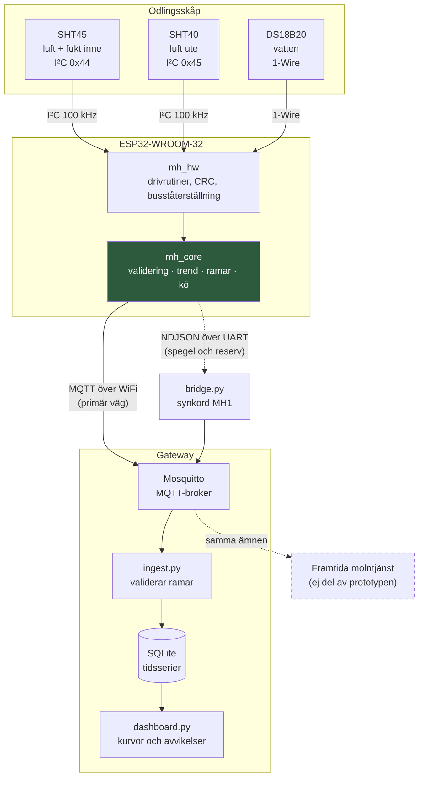

# MicroHydros, teknisk dokumentation

Prototyp 1.0 för HydroGreen Fingers AB

Det här dokumentet beskriver hur systemet är byggt och varför. De enskilda
besluten har egna underlag i [docs/adr/](adr/), som det hänvisas till löpande.

---

## Innehåll

1. [Vad prototypen gör](#1-vad-prototypen-gör)
2. [Systemarkitektur](#2-systemarkitektur)
3. [Hårdvara](#3-hårdvara)
4. [Val av givare](#4-val-av-givare)
5. [Kommunikation](#5-kommunikation)
6. [Programmets struktur](#6-programmets-struktur)
7. [Hur mätdata representeras](#7-hur-mätdata-representeras)
8. [Datakvalitet och felhantering](#8-datakvalitet-och-felhantering)
9. [Genomförda tester](#9-genomförda-tester)
10. [Kända begränsningar](#10-kända-begränsningar)
11. [Rekommendationer inför nästa fas](#11-rekommendationer-inför-nästa-fas)

---

## 1. Vad prototypen gör

Systemet mäter fyra storheter i en hydroponisk odlingsmiljö, avgör om varje
mätvärde går att lita på, räknar fram två härledda storheter, och skickar
resultatet vidare till ett externt system som lagrar historiken.

| Nr | Mätpunkt | Givare | Var |
|---|---|---|---|
| 1 | Lufttemperatur inne | SHT45 | i odlingsutrymmet |
| 2 | Lufttemperatur ute | SHT40-BD1B | utanför odlingsutrymmet |
| 3 | Vattentemperatur | DS18B20 | i näringslösningen |
| 4 | Relativ luftfuktighet inne | SHT45 | i odlingsutrymmet |

Utöver de fyra obligatoriska räknas två storheter fram ombord:

| Storhet | Varför den finns |
|---|---|
| Daggpunkt | När den närmar sig en yttemperatur bildas kondens, och kondens på blad är startskottet för mögel. |
| Ångtrycksdeficit (VPD) | Drivkraften för växtens transpiration, och den storhet odlare faktiskt reglerar efter. Typiskt 0,8 till 1,2 kPa för sallad och örter. |

Systemet upptäcker dessutom när temperaturen är på väg mot en skadlig nivå och
säger till i förväg, se [ADR-006](adr/ADR-006-forvarning.md).

---

## 2. Systemarkitektur



### Tre lager, och varför gränsen går där den går

| Lager | Ansvar | Beror på hårdvara |
|---|---|---|
| `mh_hw` | prata med kretsar, CRC, busståterställning | ja, helt |
| `mh_core` | allt beteende: validering, trend, ramar, kö | **nej, inte alls** |
| Gateway | ta emot, kontrollera ramar, lagra, visa | nej |

Det avgörande är att `mh_core` inte innehåller en enda rad hårdvarukod. Den
känner till fyra gränssnitt: `ISensor`, `IClock`, `ITransport` och `ILogger`.

Konsekvensen är att exakt samma applikationskod kan köras i tre sammanhang:

```
På ESP32       mot SHT45, DS18B20 och MQTT
På en Mac      mot simulerade givare och en NDJSON-utgång
I enhetstest   mot testdubbler där tiden och felen styrs av testet
```

Det här är inte en estetisk finess. Det är det som gjorde att logiken kunde
verifieras systematiskt, att sju simulerade dygn tar under en sekund att köra,
och att tre verkliga fel hittades innan någon hårdvara var inblandad. Se
[ADR-005](adr/ADR-005-plattform.md).

### Var beslut fattas

En fråga som går igen i arkitekturen: vem avgör vad?

| Fråga | Avgörs av | Varför just där |
|---|---|---|
| Är mätvärdet rimligt? | **Enheten** | Bara den ser hela serien med tio sekunders upplösning, och bara den fungerar när nätet ligger nere. |
| Vart är temperaturen på väg? | **Enheten** | Fysiken sitter i skåpet. Enheten ska kunna resonera om det utan uppkoppling. |
| Är ramen begriplig? | **Gatewayen** | Schemaversion, obligatoriska fält, dubbletter, hål i löpnummerserien. |
| Är det värt att väcka någon? | **Gatewayen** | Larmpolicyn beror på odlingen och på vem som får notisen, och ska gå att ändra utan att flasha om enheter. |

---

## 3. Hårdvara

**ESP32-WROOM-32 på ett DevKitC-kort.** Motivering i
[ADR-005](adr/ADR-005-plattform.md). Kort sammanfattat: inbyggt wifi eftersom
kunden vill koppla flera enheter till en gemensam tjänst, gott om minne så att
telemetrikön kan allokeras statiskt, och inget filsystem som kan korrumperas när
en odlingsenhet i ett hem förlorar strömmen.

### Anslutning

```
ESP32 DevKitC                                      4,7 kΩ pullup
                                                   mot 3V3 på varje buss
GPIO21  SDA  ──┬── SHT45   inne    I²C 0x44
               └── SHT40   ute     I²C 0x45
GPIO22  SCL  ──┴──

GPIO4   DQ   ───── DS18B20 vatten  1-Wire

3V3          ───── matning till alla tre
GND          ───── gemensam jord
```

GPIO4 är valt medvetet. Flera av ESP32:ns pinnar har funktioner vid uppstart:
GPIO0 styr bootläget, GPIO2 och GPIO15 likaså, och GPIO12 bestämmer
flashspänningen och kan göra kortet ostartbart om den dras hög vid reset. GPIO4
är fri från allt sådant.

I²C körs i 100 kHz och inte 400 kHz. Givarna sitter i andra änden av en kabel i
en fuktig miljö, och den lägre hastigheten ger bättre marginal mot
kabelkapacitansen. Vi läser fyra tal var tionde sekund, så hastighet behövs inte.

### Komponentlista

| Antal | Komponent | Ungefärligt pris |
|---|---|---|
| 1 | ESP32-WROOM-32 DevKitC | 80 kr |
| 1 | SHT45 breakout (I²C 0x44) | 90 kr |
| 1 | SHT40-BD1B breakout (I²C 0x45) | 60 kr |
| 1 | DS18B20 i vattentät rostfri sond, 1 m kabel | 70 kr |
| 3 | 4,7 kΩ motstånd | 3 kr |
| 1 | Kopplingsdäck och kablage | 50 kr |
| | **Summa** | **ca 350 kr** |

### Resursanvändning

Uppmätt vid bygge, inte uppskattat:

```
RAM    79 148 byte av 327 680     24,2 %
Flash 783 785 byte av 1 310 720   59,8 %
```

Av RAM-användningen är 32 kB telemetrikön, 16 ramar à 2 kB. Resten är WiFi- och
MQTT-stackarna.

---

## 4. Val av givare

Kunden har förbjudit DHT11 och DHT22 och skriver att de var missnöjda med
mätkvalitet och stabilitet. Hela jämförelsen och motiveringen finns i
[ADR-001](adr/ADR-001-sensorval.md). Sammanfattningen:

| Egenskap | DHT22 (förbjuden) | SHT45 (vald) | Förbättring |
|---|---|---|---|
| Temperatur | ±0,5 °C | ±0,1 °C | 5× |
| Fuktighet | ±2 till 5 %RH | ±1,0 %RH | 2 till 5× |
| Upplösning | 0,1 | 0,01 | 10× |
| Felkontroll | enkel summa | CRC8 per storhet | avgörande |
| Långtidsdrift | ospecificerad | <0,2 %RH och <0,02 °C per år | avgörande |
| Gränssnitt | eget tidskritiskt 1-tråds | I²C | robust |

**Det viktigaste är inte noggrannheten utan CRC8.** Utan checksumma går det inte
att skilja "givaren mäter fel" från "bussen störde ut". De två kräver helt olika
åtgärder, och hela valideringskedjan i avsnitt 8 bygger på den skillnaden.

**Varför två givare ur samma familj.** SHT45 inne där besluten fattas, den
enklare SHT40 ute där kravet bara är en referens. Vinsten är att det blir samma
drivrutin, och eftersom SHT40-BD1B sitter på adress 0x45 medan SHT45 sitter på
0x44 kan de dela buss utan multiplexer.

**Varför DS18B20 för vatten.** Den enda kanalen där givaren måste sitta nere i
vätskan, vilket i praktiken utesluter allt som inte finns i en färdig tät sond.
±0,5 °C räcker gott när det som spelar roll är om lösningen ligger rätt och hur
den rör sig. Analog NTC valdes bort eftersom ESP32:ns ADC är olinjär och kräver
kalibrering per enhet, och framför allt eftersom ett analogt värde saknar
checksumma: ett glapp blir då ett tyst felaktigt mätvärde istället för ett
upptäckt fel.

---

## 5. Kommunikation

**MQTT över WiFi som primär väg, radbaserad UART som spegel och reservväg.**
Motivering i [ADR-002](adr/ADR-002-kommunikation.md).

Det avgörande kravet kom från kundbrevet: de har inte valt molnplattform än, så
lösningen får inte låsa fast dem. Med MQTT känner enheten bara till en broker och
ett ämnesnamn. Vem som lyssnar är enhetens ensak, och alla större
molnplattformar talar samma protokoll.

### Ämnen

```
microhydros/v1/<device_id>/telemetry    varje minut,      inte retained
microhydros/v1/<device_id>/status       var femte minut,  retained + LWT
```

Versionsnumret ligger både i sökvägen och i nyttolasten. I sökvägen för att nya
enheter ska kunna publicera på `v2` medan gamla fortsätter på `v1` under en
övergång. I nyttolasten för att en mottagare som läser ur en loggfil inte har
ämnesnamnet kvar.

**Last Will and Testament** är konfigurerat på statusämnet. Brokern får redan vid
uppkopplingen ett färdigskrivet offline-meddelande som den publicerar om enheten
försvinner utan att säga hejdå. Utan det ser en enhet som tappat strömmen exakt
likadan ut som en enhet som bara är tyst just nu.

### Den seriella vägen

Allt som går ut på MQTT speglas på UART i formatet:

```
MH1 <ämne> <json>
```

Synkordet `MH1` finns för att en UART-länk aldrig är ren. En ESP32 skriver ut sin
bootloaderlogg i 74880 baud innan applikationen tar över i 115200, firmwarens
egna loggrader börjar med `[mh]`, och efter en omstart mitt i en sändning kommer
en halv rad. Bryggan kastar allt som inte börjar rätt och räknar hur mycket,
istället för att snubbla eller tyst ge färre mätvärden.

En detalj som är lätt att göra fel: **spegeln får aldrig kvittera en ram som
levererad.** MQTT avgör ensam. Skulle UART kunna kvittera skulle enheten sluta köa
när wifi ligger nere, eftersom den tror att ramarna kom fram, och mätdata skulle
försvinna utan att någon märkte det.

---

## 6. Programmets struktur

```
firmware/
├── platformio.ini            tre byggmiljöer
├── src/
│   ├── main.cpp              ESP32: kopplar ihop drivrutiner med applikationen
│   ├── simnode_main.cpp      dator: kopplar ihop simulering med applikationen
│   └── config.h              allt som skiljer en enhet från en annan
├── lib/
│   ├── mh_core/              ren C++17, inga hårdvaruberoenden
│   │   ├── Measurement.h     mätvärdesmodell med kvalitet och orsak
│   │   ├── Interfaces.h      ISensor, IClock, ITransport, ILogger
│   │   ├── Validator.*       fem lager plus korskontroller
│   │   ├── TrendEstimator.h  modellidentifiering och förvarning
│   │   ├── Scheduler.*       kooperativ tidtabell, klarar millis-varvet
│   │   ├── JsonWriter.*      serialisering utan heap
│   │   ├── Telemetry.*       ramformat och kö
│   │   ├── RingBuffer.h      fix buffert
│   │   ├── Psychrometrics.*  daggpunkt och VPD
│   │   ├── LineTransport.*   NDJSON och TeeTransport
│   │   └── MicroHydrosApp.*  hela beteendet
│   ├── mh_sim/               termisk modell och simulerade givare
│   └── mh_hw/                ESP32: SHT4x, DS18B20, MQTT, busståterställning
└── test/                     82 enhets- och integrationstester

gateway/
├── bridge.py                 UART eller stdin → MQTT
├── ingest.py                 MQTT → validering → SQLite
├── dashboard.py              SQLite → kurvor och avvikelser
├── schema.sql                tidsseriemodell
└── docker-compose.yml        broker + mottagare + panel
```

### Huvudloopen blockerar aldrig

```cpp
void loop() {
    g_app.loop();        // gör det som är dags, returnerar direkt
    esp_task_wdt_reset();
    delay(20);
}
```

`delay()` i loopen är en av de vanligaste orsakerna till att första prototyper
blir ostabila. Under en delay svarar enheten inte på nätverket, matar inte
watchdogen och kan inte reagera på något. Här finns istället en tidtabell, och
varje uppgift gör sitt och lämnar tillbaka kontrollen.

Två ställen där det krävde omtanke:

**DS18B20 tar upp till 750 ms på sig.** Den naiva drivrutinen gör convert,
`delay(750)`, read. Här startas konverteringen vid en avläsning och resultatet
hämtas vid nästa, tio sekunder senare. Värdet är då tio sekunder gammalt, vilket
för vatten med en tidskonstant på halvannan timme motsvarar några tusendels
grader, alltså långt under givarens egen upplösning.

**Tidsjämförelserna klarar att `millis()` slår runt** efter 49,7 dygn. De är
skrivna som osignerad subtraktion, `(int32_t)(now - deadline) >= 0`, istället för
`now >= deadline`. En schemaläggare skriven på det senare sättet slutar tyst
fungera efter sju veckor, vilket aldrig syns på en demonstration. Det finns ett
test som stegar klockan förbi varvet.

### Tidtabell

| Var | Vad |
|---|---|
| 10 s | läs alla fyra kanaler, validera, korskontrollera, mata trendfönstret |
| 60 s | bygg telemetriram, skicka eller köa |
| 300 s | skicka statusram |
| varje varv | töm kön om nätet är uppe, högst fyra ramar åt gången |

Motivering för takterna i [ADR-003](adr/ADR-003-samplingsintervall.md).

### Ingen heapallokering i drift

Inga `new`, inga `std::string`, inga dynamiska containrar i `mh_core`. Allt är
POD med känd storlek. Telemetrikön är en `RingBuffer<Frame, 16>` som allokeras
vid länkning.

Skälet är att en fragmenterad heap är en av de vanligaste orsakerna till att en
enhet som fungerat i veckor plötsligt slutar. Det är också ett fel som aldrig
syns under en demonstration.

Samma resonemang gäller JSON-skrivaren, som fyller en buffert anroparen äger och
flaggar overflow istället för att växa. Den har dessutom egen
flyttalsformatering istället för `snprintf("%f")`, eftersom flyttalsstöd i printf
är bortoptimerat på många embedded-byggen för att spara flash, vilket gör att
mätvärden skrivs ut som tomma strängar.

---

## 7. Hur mätdata representeras

### Grundprincipen

**En mätning är aldrig bara ett tal.** Den bär alltid med sig vad den mäter, var,
när, och hur mycket systemet litar på den.

```cpp
struct Measurement {
    char     sensor_id[12];   // "air_in", "water", ...
    Quantity quantity;        // air_temperature, relative_humidity, ...
    Location location;        // inside, outside, water, derived
    Quality  quality;         // good, suspect, bad
    Reason   reason;          // varför inte good
    float    value;           // NaN om quality == bad
    uint32_t timestamp_ms;    // monoton, inte väggur
};
```

### Telemetriramen

```json
{
  "schema_version": 1,
  "device_id": "microhydros-01",
  "seq": 60,
  "uptime_ms": 3600000,
  "sample_interval_ms": 10000,
  "measurements": [
    {
      "sensor_id": "air_in",
      "quantity": "air_temperature",
      "location": "inside",
      "unit": "degC",
      "value": 27.780,
      "quality": "good",
      "reason": "none",
      "t_ms": 3591000
    },
    {
      "sensor_id": "water",
      "quantity": "water_temperature",
      "location": "water",
      "unit": "degC",
      "value": null,
      "quality": "bad",
      "reason": "checksum_failed",
      "t_ms": 3591000
    }
  ],
  "trend": {
    "channel": "air_in",
    "direction": "rising",
    "slope_per_hour": 39.610,
    "r_squared": 0.800,
    "slope_ratio": 0.742,
    "limit_exceeded": false,
    "projected_equilibrium_c": 32.50,
    "tau_minutes": 7.8,
    "samples": 36,
    "limit_c": 30.0,
    "minutes_to_limit": 7.2
  },
  "health": {
    "free_heap_bytes": 201344,
    "dropped_frames": 0,
    "queued_frames": 0,
    "bus_errors": 0,
    "wifi_rssi_dbm": -58
  }
}
```

### Varför fälten ser ut som de gör

| Fält | Varför det finns |
|---|---|
| `schema_version` | Mottagaren kan avgöra om den förstår ramen. Utan det blir varje framtida fältändring en utrullning där enhet och backend måste bytas samtidigt. |
| `seq` | Monotont löpnummer. Gör att gatewayen ser att ram 41 saknas, även om den aldrig kom fram. Utan löpnummer är tappad data osynlig. |
| `uptime_ms` | Monoton tid. Enheten har ingen batteribackad realtidsklocka och ska hellre tiga än gissa vad klockan är. Gatewayen sätter mottagningstid och kan räkna bakåt. |
| `quality` + `reason` | Skillnaden mellan `checksum_failed` och `no_response` är skillnaden mellan "se över kabeln" och "givaren är borta". Gör fjärrfelsökning möjlig. |
| `value: null` | Ett underkänt värde får aldrig `0`. En nolla ser ut som en riktig mätning nere vid nollstrecket. |
| `unit` | Gör nyttolasten självbeskrivande. Vilken mottagare som helst kan rendera rätt utan en uppslagstabell. |
| `health` | Ett fjärrplacerat system som inte rapporterar om sig självt går inte att felsöka utan att åka dit. |

### Lagringsmodellen

Gatewayen lagrar **en rad per mätvärde**, inte en rad per ram.

```sql
CREATE TABLE measurements (
    id, frame_id, device_id, sensor_id, quantity, location, unit,
    value,        -- NULL när quality = 'bad'
    quality, reason, device_t_ms, received_utc
);
```

Skälet är utbyggbarhet. Hade varje ram blivit en rad med kolumnerna `air_in`,
`air_out`, `water` och `rh_in` hade vi behövt en migrering den dagen kunden vill
mäta pH eller ledningstal, vilket är en trolig utveckling för ett hydroponiskt
system. Med en rad per mätvärde är det inget som behöver ändras.

Två vyer gör det som är intressant lätt att fråga efter utan att skriva SQL:

| Vy | Svarar på |
|---|---|
| `v_sensor_health` | Går det att lita på den här givaren? Antal godkända, tveksamma och underkända per givare. |
| `v_sequence_gaps` | Har data gått förlorad? Hål i löpnummerserien per enhet. |

---

## 8. Datakvalitet och felhantering

Fullständig beskrivning i [ADR-004](adr/ADR-004-validering.md). Det här är
kärnan i svaret på kundens problem med den förra prototypen.

### Utgångspunkten

En trasig givare slutar nästan aldrig svara. Den fortsätter svara, men fel, och
felet ser ut som ett helt vanligt mätvärde:

| Vad som händer | Vad givaren säger | Ser det fel ut? |
|---|---|---|
| DS18B20 tappar kontakt | **exakt +85,0 °C** | Nej, ett normalt tal inom mätområdet |
| Kondens i fuktgivaren | **100 %RH i timmar** | Nej, full mättnad är ett giltigt tillstånd |
| I²C-bussen hänger sig | **samma register igen och igen** | Nej, värdet är rimligt och derivatan noll |

### Fem lager plus korskontroller

| Lager | Frågan som ställs | Utfall |
|---|---|---|
| L1 | Stämmer CRC8? Svarade kretsen? | `bad` |
| L2 | Ligger värdet inom databladets mätområde? | `bad` |
| L3 | Är det rimligt för en odling? | `suspect` |
| L4 | Kan det ha ändrat sig så snabbt? | `suspect` |
| L5 | Har värdet fastnat? | `suspect` |

| Korskontroll | Fysisk grund | Fångar |
|---|---|---|
| Daggpunkt ≤ lufttemperatur | definitionsmässigt omöjligt annars | temp- eller fuktkanalen ljuger |
| Vatten inom 15 °C från luften | termisk koppling i litet skåp | sonden har lossnat ur kärlet |
| Inne ≥ ute − 5 °C | lampa och pump tillför effekt | luftgivarna monterade åt fel håll |

Korskontrollerna är värdefulla just för att de fångar fel där varje enskild kanal
ser helt frisk ut. Två förväxlade luftgivare ger två fullständigt normala
mätvärden.

### Underkända värden kastas aldrig bort

Ett mätvärde som inte håller måttet skickas ändå vidare med sin kvalitetsflagga
och orsakskod, och lagras. Tre konsekvenser:

1. En graf kan rita ett hål där data saknas, istället för att dra en rak linje
   över ett fel som ingen upptäckte.
2. Felfrekvensen går att räkna på i efterhand, vilket är underlaget för frågan
   "går det att lita på den här givaren".
3. Orsakskoden gör fjärrfelsökning möjlig.

### Åtgärder utöver markering

| Situation | Vad systemet gör |
|---|---|
| Fem bussfel i rad | initierar om givarna, `ChannelValidator` nollställs |
| Hängd I²C vid uppstart | klockar fram slaven med upp till nio pulser och avslutar med stoppvillkor |
| Nätet nere | köar upp till 16 ramar, tömmer högst fyra per varv vid återkomst |
| Kön full | tappar äldst först och **rapporterar antalet** i `dropped_frames` |
| Givare saknas vid start | startar ändå, rapporterar de tre som fungerar |
| Applikationen hänger | watchdog startar om kortet efter 30 s |

Valet att starta även när en givare saknas är medvetet. Ett halvt fungerande
system som berättar vad som är trasigt är mer värt för kunden än ett som bara
blinkar.

---

## 9. Genomförda tester

Fullständig rapport med förväntat och faktiskt resultat i
[testrapport.md](testrapport.md). Sammanfattning:

| Svit | Antal | Vad som verifieras |
|---|---|---|
| Validering | 17 | varje felmod, plus motprov att friska givare inte larmar |
| Trend och förvarning | 15 | lutning, modellidentifiering, falsklarm i båda riktningarna |
| JSON och telemetri | 9 | format, buffertbudget, NaN blir null |
| Schemaläggare | 8 | takt, ikappkörning, millis-varvet |
| Ringbuffert | 8 | FIFO, överskrivning, tiotusen varv |
| Psykrometri | 9 | mot tabellvärden |
| Integration | 16 | hela applikationen mot simulerad odling, sju dygn |
| **Totalt** | **82** | körs på **under 6 sekunder** |

Utöver enhetstesterna kördes fyra scenarier genom hela kedjan från
simuleringsnod till databas: normaldrift, injicerade givarfel, nätavbrott och
skenande uppvärmning.

### De tre felen som testerna hittade

Värt att lyfta separat, eftersom de visar vad testuppsättningen var värd:

| Fel | Hur det hittades | Konsekvens om det inte hittats |
|---|---|---|
| Telemetriramen fick inte plats i bufferten (640 byte, behövde 2048) | budgettest | enheten hade varit **helt tyst** i fält utan att något loggades som fel |
| 41 falsklarm på sex timmar vid normal lampstart | körning av hela kedjan | kunden hade stängt av notifieringarna första veckan |
| 3,6 % av vattenmätningarna underkända i felfri drift | databasfråga efter körning | larm som ingen litar på |

Det första är värt att stanna vid. `encodeTelemetry` returnerade 0, ingen ram
byggdes, och enheten hade fortsatt mäta och validera helt korrekt utan att skicka
ett enda värde. Det är exakt den sortens tysta fel kunden beskrev från sin förra
leverantör, och det hittades av ett test som bara kontrollerar att den största
möjliga ramen får plats.

### Är mätvärdena rimliga?

En ram från normaldrift, med lampan tänd:

| Storhet | Värde | Rimlighetsbedömning |
|---|---|---|
| Luft inne | 27,78 °C | Rummet är 21,4 °C och lampan tillför runt 6 °C. Stämmer. |
| Luft ute | 21,35 °C | Normal rumstemperatur. |
| Vatten | 23,25 °C | Mellan rummet och skåpsluften. Vattnet släpar efter luften, precis som tidskonstanten säger. |
| Fukt inne | 62,78 %RH | Slutet skåp med öppet vattenkärl. Rimligt. |
| Daggpunkt | 20,04 °C | Ligger 7,7 °C under lufttemperaturen, alltså ingen kondensrisk. Måste per definition vara lägre än luften, och är det. |
| VPD | 1,387 kPa | Strax över det rekommenderade intervallet 0,8 till 1,2 för sallad, vilket är förväntat när lampan värmt upp luften. |

Den interna konsistensen är det som säger mest. Daggpunkten ligger under
lufttemperaturen, vattnet mellan rummet och skåpsluften, och VPD stämmer med
temperatur och fuktighet. Enskilda tal kan vara fel utan att man ser det, men sex
storheter som alla hänger ihop fysikaliskt är svåra att få rätt av misstag.

---

## 10. Kända begränsningar

Ärlighet här är viktigare än att listan är kort.

### 10.1 Prototypen är verifierad i simulering, inte på fysisk hårdvara

**Detta är den viktigaste begränsningen och den ska läsas först.**

Firmwaren kompilerar för ESP32 och drivrutinerna är skrivna mot databladen för
SHT4x och DS18B20, men prototypen har inte körts mot fysiska givare. All
verifiering har skett mot en fysikalisk simuleringsmodell av odlingsskåpet med
injicerade fel.

**Vad detta betyder att vi vet:**

- Applikationslogiken är verifierad, och den är bit för bit samma kod som körs på
  kortet. Validering, trendmodell, kö, ramformat och kommunikationskedja är
  genomgångna med 82 tester och fyra hela scenariokörningar.
- Hela kedjan från mätvärde till databas fungerar, med en riktig MQTT-broker och
  riktig lagring.

**Vad detta betyder att vi inte vet:**

- Att I²C-kommunikationen fungerar med den valda kabellängden och de valda
  pullup-motstånden.
- Att timingen i 1-Wire-drivrutinen stämmer mot en verklig DS18B20.
- Hur mycket egenuppvärmning ESP32:n ger den inre luftgivaren om de monteras
  nära varandra.
- Hur givarna beter sig vid verklig kondens.
- Om de antagna tidskonstanterna, 8 minuter för luft och 90 för vatten, stämmer
  för ett verkligt skåp. Valideringsgränserna i
  [ADR-004](adr/ADR-004-validering.md) vilar på dem.

**Första steget i nästa fas måste därför vara en hårdvaruverifiering.** Ett
konkret förslag: montera givarna, kör ett dygn, och jämför de uppmätta
tidskonstanterna mot modellens. Stämmer de behöver inga gränser ändras. Stämmer
de inte är det `ChannelLimits` och `kTrendWindow` som ska justeras, och båda är
enskilda konstanter.

### 10.2 Övriga begränsningar

| Område | Begränsning | Allvar | Åtgärd |
|---|---|---|---|
| Säkerhet | Ingen TLS, öppen broker, ingen autentisering per enhet | **Hög** i skarp drift | TLS plus certifikat per enhet, rader förberedda i `mosquitto.conf` |
| Hemligheter | WiFi-lösenord som kompilerad konstant i `config.h` | **Hög** | läs ur NVS vid uppstart |
| Leveransgaranti | PubSubClient stödjer bara QoS 0 | Medel | ESP-IDF:s MQTT-klient ger QoS 1 |
| Buffring | 16 ramar, alltså 16 minuters avbrott | Medel | skriv till NVS vid längre avbrott |
| Drift över tid | Långsam givardrift upptäcks inte | Medel | referensgivare eller statistik över månader i molnet |
| Tidsstämpel | Enheten har ingen realtidsklocka | Låg | NTP vid uppstart, eller behåll monoton tid och låt gatewayen tidsstämpla |
| Aggregering | Endast senaste värdet skickas, inte min/max/medel | Låg | räkna i `MicroHydrosApp`, liten ändring |
| Larm | Ingen hysteres, ett pendlande klimat ger upprepade larm | Låg | återställningströskel |
| Konfiguration | Gränsvärden är kompilerade konstanter | Låg | flytta till NVS |
| Skalning | En SQLite-fil, en gateway | Låg | tidsseriedatabas när enheterna blir många |

### 10.3 Det som medvetet inte byggdes

Uppgiften listar detta som frivilligt, och kunden skriver att en liten lösning
som fungerar stabilt är mer värd än en stor där mycket fungerar delvis. Vi höll
oss till det.

Inte byggt: färdig molnplattform, mobilapp, avancerat webbgränssnitt,
maskininlärning, automatisk bevattning eller belysningsstyrning, färdig fysisk
produktdesign.

---

## 11. Rekommendationer inför nästa fas

I prioritetsordning.

### Först: verifiera mot fysisk hårdvara

Beskrivet i 10.1. Allt annat bör vänta tills det är gjort, eftersom resultatet
kan påverka valideringsgränserna.

Konkret plan: montera givarna enligt kopplingsschemat, kör ett dygn med
fotoperiod, och mät de verkliga tidskonstanterna för luft och vatten. Jämför mot
modellens 8 och 90 minuter. Kontrollera samtidigt hur mycket ESP32:ns
egenuppvärmning påverkar den inre luftgivaren.

### Sedan: säkerheten

TLS på brokern, certifikat eller lösenord per enhet, och behörighetsregler så att
en enhet bara får publicera på sitt eget ämne. WiFi-uppgifterna ur `config.h` och
in i NVS. Det här är det som skiljer en prototyp från något som får stå hemma hos
en kund.

### Sedan: leveransgaranti

Byt till ESP-IDF:s MQTT-klient för QoS 1. Det berör bara `mh_hw`. Överväg
samtidigt att buffra till NVS vid avbrott längre än sexton minuter.

### Därefter, i den ordning kunden prioriterar

**Analysen till molnet.** Enheten ska fortsätta göra den snabba bedömningen,
eftersom den är den enda som fungerar utan uppkoppling. Men långsam drift,
jämförelser mellan enheter och säsongsmönster kräver månader av historik och hör
hemma där historiken ligger. Datamodellen är redan byggd för det.

**Fler mätpunkter.** pH och ledningsförmåga är naturliga nästa steg för
hydroponik. Lagringsmodellen klarar det utan migrering. Räkna dock med att
kalibrering blir ett eget problem, eftersom pH-elektroder driver och måste
kalibreras om regelbundet.

**Aggregering.** Skicka min, max, medel och antal per minut istället för bara det
senaste värdet. Då syns kortvariga spikar som inte råkade hamna på
publiceringstillfället.

**Inställbara gränser per odling.** Basilika och sallad tål olika mycket.

---

## Svar på kundens frågor

> **Vilka sensorer är lämpliga för MicroHydros?**

SHT45 för luft och fukt inne, SHT40-BD1B för luft ute, DS18B20 i vattentät sond
för näringslösningen. Det avgörande är inte noggrannheten utan att alla tre har
CRC på varje mätvärde, vilket gör att systemet kan skilja ett mätfel från ett
transportfel. Hela jämförelsen i [ADR-001](adr/ADR-001-sensorval.md).

> **Hur ofta bör miljödata mätas?**

Mät var tionde sekund, skicka varje minut. Den täta mätningen behövs inte för att
beskriva klimatet utan för att kunna avgöra om ett mätvärde är tillförlitligt:
ju tätare mätpunkterna ligger, desto mindre utrymme finns för ett felaktigt värde
att se ut som en verklig förändring. Se
[ADR-003](adr/ADR-003-samplingsintervall.md).

> **Hur kan mätdata struktureras och kommuniceras?**

Som versionerad JSON där varje mätvärde bär med sig storhet, enhet, plats,
tidpunkt och en kvalitetsflagga med orsakskod. Över MQTT, så att enheten bara
känner till en broker och inte en specifik molnplattform. Se avsnitt 5 och 7.

> **Hur kan systemet upptäcka felaktiga eller orimliga mätvärden?**

Genom att ställa fem olika frågor om varje mätvärde, eftersom ingen enskild fråga
räcker, och sedan genom att jämföra givarna mot varandra. Det som inte upptäcks
är långsam drift, och det kräver antingen en referensgivare eller månaders
historik. Se [ADR-004](adr/ADR-004-validering.md).

> **Hur bör en framtida produkt byggas för att enkelt kunna vidareutvecklas?**

Genom att hålla applikationslogiken helt fri från hårdvaruberoenden. I den här
prototypen betydde det att samma kod kunde köras på kortet, i simulering och i
enhetstester, vilket i sin tur var det som gjorde att tre verkliga fel hittades
innan hårdvaran ens var inblandad. Ett byte av givare eller mikrokontroller berör
bara `mh_hw`. Se [ADR-005](adr/ADR-005-plattform.md).

> **Vilka risker och begränsningar ser utvecklingsteamet?**

Den största är att prototypen är verifierad i simulering och inte mot fysiska
givare, se 10.1. Därefter säkerheten, som inte är löst alls och måste vara det
innan något står hemma hos en kund. Därefter att långsam givardrift, som
sannolikt var en del av problemet med den förra prototypen, fortfarande inte
upptäcks av systemet självt.
